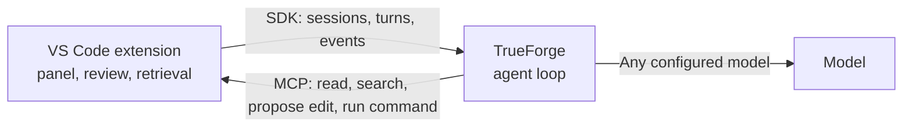

# Synapse

An editor-native coding agent for VS Code, whose agent loop runs on
[TrueForge](https://github.com/truefoundry/trueforge). Built for the TrueFoundry Forge-a-thon at Techfest 2026-27.

Give it a request. It finds the right code in a repository too large for any context window, proposes a multi-file change you
never had to spell out, shows every hunk for review before anything touches disk, and keeps working when the model behind it
fails.

> **Status:** early. All five required capabilities are written and their logic is tested, but it has not yet run against a live
> TrueForge or inside VS Code. [What is verified, and what to do first](docs/progress/README.md).

"Synapse" is a working name, taken from the repository's name.

## Quick start

You need [Node.js](https://nodejs.org) 22.14 or newer, git, and VS Code 1.95 or newer. The Flask demo also needs Python 3.

**1. Install and build.**

```bash
npm ci
```

```bash
npm run build
```

**2. Start TrueForge locally,** in its own terminal. This wraps `npx @truefoundry/trueforge` and allows it to reach the extension,
which a bare `npx` would not. Leave it running. Its UI is at <http://localhost:8790>.

```bash
npm run trueforge
```

**3. Check the TrueForge behaviour we rely on.** This needs no API key.

```bash
npm run smoke
```

**4. Configure a model.** Copy the example, edit it, and put any keys in `.env`. Keys never go in the config file. To try it with no key
or cost, skip the copy, run `npm run mock-model` in another terminal, and pass `-- --config agent/models.mock.example.json` to the last
command instead.

```bash
cp agent/models.example.json agent/models.json
```

```bash
cp .env.example .env
```

```bash
npm run setup:models
```

It prints a `synapse.models` value to add to your VS Code user settings. That is how you switch models: the first is the primary, and
the rest are automatic fallbacks.

**5. Get the pinned Flask repository** the fixed tasks use.

```bash
npm run demo:flask -- setup
```

**6. Run the extension.** Open this folder in VS Code and press **F5**. A second window opens on the Flask checkout. Run
**Synapse: Check TrueForge Setup** from the Command Palette, and it will say what is wrong if anything is.

**The agent definitions load by themselves:** the extension creates each TrueForge session from
[agent/definitions](agent/definitions) ([why](docs/decisions/0005-client-side-model-fallback.md)).

## Using it

| To | Do |
| --- | --- |
| Edit a selection | Select code, press `Ctrl+Alt+K` (`Cmd+Alt+K` on Mac), and describe the change |
| Run the agent on a task | Open the Synapse panel from the activity bar and describe the change. You do not need to name files |
| Point at something | Type `@` in the panel to mention a file or symbol |
| Review a hunk | Use Accept or Reject above it, or `Alt+Y` and `Alt+N`, with `Alt+]` and `Alt+[` to move between hunks |
| Stop a run | Stop button, or `Ctrl+Alt+.`. The workspace is put back as it was |
| Take a change back | **Undo last change** or **Undo last run** in the panel |
| See what the agent did | **Open session in TrueForge**, which opens the run's turns and tool calls in TrueForge's UI |

## How it works



- TrueForge runs the loop. The extension never calls a model provider, and editor capabilities reach the agent only as MCP tools.
- Writing tools pause on TrueForge's tool approval, which opens a per-hunk review. A second lock refuses any write without a matching approval.
- Before the model starts, budgeted retrieval picks the code to include, and the panel shows each choice and why.
- Cancelling or failing restores every file the run changed. Completed runs can be undone.
- When a model fails, the extension retries with backoff, then moves to the next model configured in TrueForge.

More in [docs/architecture](docs/architecture/README.md), with the trade-offs in [docs/decisions](docs/decisions/README.md).

## Starting point

**From scratch.** This is not a fork, and no upstream code was copied. [Why](docs/decisions/0001-start-from-scratch.md). Ordinary dependencies are
listed in [extension/package.json](extension/package.json), and the project is under the [MIT License](LICENSE).

If that changes, this section must name the upstream repository and exact commit, and describe what changed and why.

## Repository map

| Path | What is there |
| --- | --- |
| [extension/](extension/README.md) | The VS Code extension |
| [agent/](agent/README.md) | Agent definitions, example model configuration, TrueForge scripts |
| [tests/](tests/README.md) | Tests, and guidance on writing them |
| [examples/](examples/README.md) | The Flask demo and a scripted model for working with no API key |
| [docs/competition/](docs/competition/README.md) | The rules, scoring, fixed tasks, demo script and write-up template |
| [docs/architecture/](docs/architecture/README.md) | How it works, and the [context strategy](docs/architecture/context-strategy.md) |
| [docs/decisions/](docs/decisions/README.md) | Why it works that way, and what is still the team's to decide |
| [docs/research/](docs/research/trueforge-findings.md) | What we learned about TrueForge and the upstream editors |
| [docs/progress/](docs/progress/README.md) | Status, plan and [backlog](docs/progress/backlog.md) |

## Developing

```bash
npm run check
```

Type checks, tests and builds. `npm run test:golden` also checks retrieval against the pinned Flask repository, and
[CONTRIBUTING.md](CONTRIBUTING.md) has the rest.

## Team

TBD.

## License

[MIT](LICENSE)
