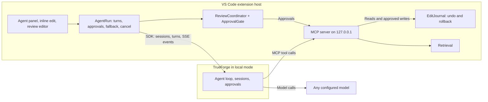
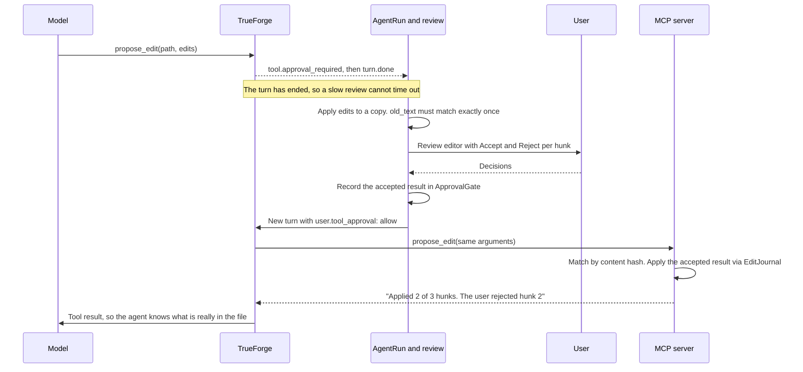

# Architecture

The extension is a client of a TrueForge agent. TrueForge owns the loop: streaming, session state, tool
plumbing and approvals. We own what the model sees and how safe and fast the editor feels. Decisions are
in [docs/decisions](../decisions/README.md), and each TrueForge behaviour relied on here is sourced in
[docs/research](../research/trueforge-findings.md).

The extension never talks to `Provider`. That is the eligibility rule, and a test enforces it.

## Code map

| Path | Responsibility | Imports `vscode`? |
| --- | --- | --- |
| `extension/src/core/agentRun.ts` | One request from first token to a consistent workspace | No |
| `extension/src/core/review.ts` | Turns an approval pause into a per-hunk review | No |
| `extension/src/core/approvalGate.ts` | Second lock on writes: no approval, no write | No |
| `extension/src/core/hunks.ts` | Hunks, partial application, the merged review document | No |
| `extension/src/core/journal.ts` | Records every write, for undo and rollback | No |
| `extension/src/core/retrieval.ts` | Context selection within a budget | No |
| `extension/src/core/mentions.ts` | `@file` and `@symbol`, the ledger, the first message | No |
| `extension/src/core/fallback.ts` | Retry, backoff and the model chain | No |
| `extension/src/mcp/` | The MCP server and the eight tools | No |
| `extension/src/trueforge/gateway.ts` | Maps SDK events to what `AgentRun` needs | No |
| `extension/src/editor/` | Panel, review editor, workspace access, wiring | Yes |
| `agent/definitions/` | The agent definitions, in TrueForge's wire format | |

Everything above the editor layer is testable without VS Code, which is why the tests can cover it.

## Tools

| Tool | Loaded | Gated | Purpose |
| --- | --- | --- | --- |
| `retrieve_context` | Preloaded | No | Ranked snippets within a budget, with reasons |
| `read_file` | Preloaded | No | Read a file or a line range |
| `search_workspace` | Preloaded | No | Text or regex search |
| `find_symbol` | Deferred | No | Where a symbol is defined |
| `list_files` | Deferred | No | List paths |
| `propose_edit` | Preloaded | **Yes** | Anchored edits to an existing file |
| `create_file` | Preloaded | **Yes** | A new file |
| `run_command` | Preloaded | **Yes** | A shell command in the workspace root |

Results stay under 20,000 characters, below TrueForge's 6,000-token offload threshold. That offload is
switched off anyway, because without a sandbox it would replace a large result with a preview the agent
cannot read past ([ADR 0007](../decisions/0007-tools-bound-their-own-output.md)).

## How a change reaches disk

If every hunk is rejected, the decision is `deny` with a reason. If `old_text` is wrong, the call is denied
automatically and the user never sees a bad diff.

## Cancel

The order matters, and `AgentRun.cancel` follows it:

1. Close the gate, so a tool call that arrives late cannot write.
2. Close any open review.
3. Kill running commands, because the harness waits for running tools.
4. Stop reading the stream and ask TrueForge to cancel the turn.
5. Roll back everything this run applied.

The journal runs operations one at a time, so the rollback always sees a write already in flight. The
user's view is immediate, since nothing waits on the server.

A failed run also rolls back, and so does a turn the server cancels on its own.

## When a model fails

A turn ending in `status: error`, or a stream that throws, goes to `FallbackPolicy`:

- **Transient failure:** retry the same model with doubling backoff, up to `synapse.retry.attemptsPerModel`.
- **Auth failure:** skip retries, since they never heal.
- **Then:** `PATCH` the session to the next model in `synapse.models`, keeping its history.
- **If all fail:** roll back and show a clear message.

The request is resent if nothing had happened yet. Otherwise the new model is told to continue from where
the session is.

## Security

Repository content is untrusted input to the model, so a file could carry a prompt injection.

- Every write and command needs the user's approval, by name and by content.
- Tools stay inside the workspace and out of `.git`.
- Likely secrets (`.env`, `*.key`, `*.pem` and so on) are never read, searched, retrieved or sent.
- The MCP server binds to loopback, requires a per-activation bearer token, and checks the `Host` header,
  so a web page cannot drive it through DNS rebinding.
- TrueForge local mode has no login and should stay on localhost. The allow-list we set lets it reach only
  loopback, which is what local mode needs.
